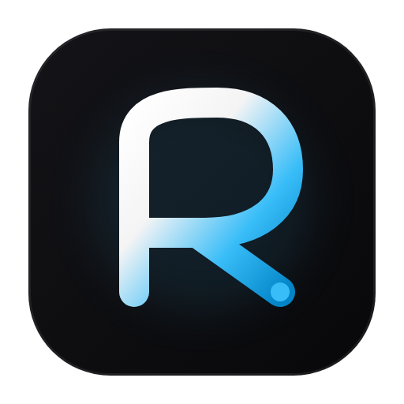
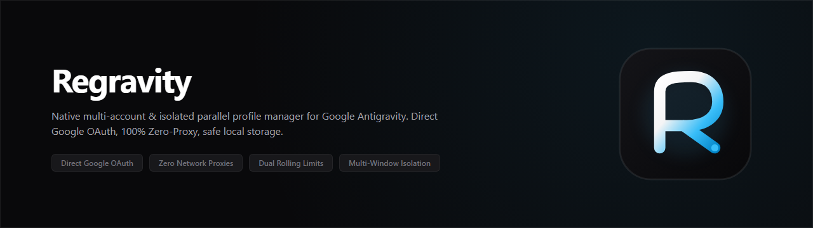

<p align="center">
  <a href="https://github.com/warhammered/regravity">
    
  </a>
</p>

<h1 align="center">Regravity</h1>

<p align="center">
  <strong>Native Multi-Account &amp; Isolated Parallel Profile Manager for Google Antigravity</strong><br>
  Instant Session Hot-Swapping • Side-by-Side Windows • Direct Google OAuth • 100% Zero-Proxy Architecture
</p>

<p align="center">
  <a href="LICENSE"></a>
  <a href="#-terms-of-service--security-guarantee"></a>
  <a href="#-terms-of-service--security-guarantee"></a>
  <a href="https://antigravity.google"></a>
  
  
</p>

<p align="center">
  
</p>

---

## 🌟 Why Regravity?

Google Antigravity is built exclusively as a single-account environment. When developers hit their **5-Hour rolling request limits** or need to segregate personal, team, and enterprise client workspaces, they face a frustrating choice: either log out repeatedly through the browser, or risk their accounts with unsafe third-party proxy rotators.

Regravity eliminates this friction by integrating directly into Antigravity's native Electron runtime and Language Server:

| Capability | Standard Antigravity | Legacy Community Proxies | **Regravity (v0.1.0)** |
| :--- | :---: | :---: | :---: |
| **Multi-Account Switching** | ❌ Manual logout / login | ⚠️ Local MITM Proxy (High Ban Risk) | ✅ **Instant Hot-Swap (<300ms)** |
| **Side-by-Side Windows** | ❌ Single instance only | ❌ Corrupts shared database lock | ✅ **Isolated Multi-Window Sandboxes** |
| **OAuth Authentication** | ⚠️ Re-login redirects | ⚠️ Token scraping & replay | ✅ **Direct Official Google OAuth** |
| **5-Hour & Weekly Limits** | ⚠️ Hidden in system prompts | ❌ Not available | ✅ **Dual Real-Time Limit Progress Bars** |
| **Project & Chat Sync** | ❌ Lost on new profiles | ❌ Disk-cloning bloat | ✅ **Zero-Bloat Directory Junctions** |
| **Theme & Customizations** | ⚠️ Reset on new sandbox | ❌ Broken styling | ✅ **100% Retained Theme & Customization** |
| **Network Architecture** | Direct to Google | ❌ Decrypted MITM Local Proxy | ✅ **100% Direct to Google (Zero Proxy)** |
| **Google ToS Safety** | Safe | ❌ Suspensions & Token Flags | ✅ **100% Google Terms Compliant** |

---

## 🛡️ Terms of Service & Security Guarantee

### Why Legacy Tools Caused Account Suspensions
Several developers using early community "rotator" or "account switcher" utilities experienced account suspensions. **Why did that happen?**
1. **MITM HTTP Proxies**: Early tools routed Antigravity traffic through local HTTP proxies, decrypting TLS traffic and tampering with HTTP headers. Google Cloud's security monitors detect altered user agents, proxy signatures, and unverified loopback hops, flagging them as credential theft or automated abuse.
2. **Internal Protocol Forgery**: Some tools attempted to forge internal gRPC calls or bypass rate limits, triggering automated account protection alarms.
3. **Unsecured Token Storage**: Plaintext token caching exposed developers to credential leaks.

### How Regravity Guarantees 100% Safety & Compliance
Regravity was built from the ground up to eliminate every single risk factor:
- **Zero-Proxy Guarantee**: Regravity **never** intercepts, modifies, or routes Antigravity's network calls. All communication between Antigravity, the Language Server, and Google's servers remains 100% direct, encrypted, and untouched.
- **Direct Official Google OAuth 2.0**: Authentication communicates solely with Google's official endpoints (`https://oauth2.googleapis.com/token` and `https://accounts.google.com/o/oauth2/auth`) via standard RFC 8252 loopback authorization.
- **Standard Chromium Sandboxing**: Parallel profile instances are created using Electron's native `--user-data-dir` flag, completely isolating SQLite databases, cookies, and memory without patching binary code.
- **Local-Only DPAPI Storage**: All tokens and secrets are stored in your operating system's native Credential Manager (Windows Credential Manager via `Advapi32.dll`) and local user directories (`~/.gemini/accounts/`). Zero telemetry, zero analytics, zero external network requests.

---

## ✨ Core Features

### 1. In-Place Session Hot-Swapping (<300ms)
Switch between personal, work, and client accounts in your existing IDE window with a single click. Regravity synchronizes the active OAuth tokens and SQLite workbench states in-place and reloads the window instantly.

### 2. Isolated Multi-Window Parallel Profiles
Need multiple accounts running simultaneously? Click **Launch Window** on any account card to open an independent Antigravity window. Each instance runs in its own process sandbox with isolated `userData` and `USERPROFILE` environments, eliminating SQLite database locks while keeping your active window untouched. Parallel profile instances automatically inherit your theme settings (`customThemeSeedsDark`), plugins, and conversations via NTFS junctions (`mklink /J`) with zero disk bloat.

### 3. Dual Rolling Limits & Detailed View
Monitor quota consumption before you hit a wall:
- **5-Hour Rolling Request Limit**: Visual percentage bar and exact reset countdown (e.g. `100% (3h 48m)`).
- **Weekly Rolling Quota**: Long-term quota health bar (e.g. `98% (5d 14h)`).
- **Session Health**: Access token expiry countdown (`48m remaining`), refresh token status, and Google Cloud scopes.

### 4. Smart Account Detection
Regravity automatically scans Windows Credential Manager, Antigravity account history, and local profile directories for existing unmanaged sessions, allowing you to import them with one click.

### 5. Headless MCP Isolation
Eliminates unwanted browser tabs popping up during launch by automatically marking remote/interactive MCP servers (such as AWS, Canva, and OpenDesign) as safe in spawned profile sandboxes.

### 6. Update Resilience Shield (Zero Disappearance)
Google Antigravity frequently updates in the background, overwriting `app.asar` and wiping third-party modifications. Regravity includes an ultra-lightweight background **Guardian Watcher** (`guardian.py`, <18MB RAM, 0.0% CPU) registered via Windows user Startup and HKCU Run keys. The moment Google Antigravity auto-updates, Guardian detects the change within seconds, synchronizes the factory backup with the new build, and silently re-applies Regravity in-place. Your Account Manager sidebar button, parallel window support, and accounts permanently survive all Google updates without requiring manual re-installation.

---

## 🏛️ Architecture

Regravity operates entirely within Antigravity's native Electron and Language Server architecture:

```
┌────────────────────────────────────────────────────────────────────────┐
│                     Google Antigravity Main Window                     │
│                                                                        │
│  ┌───────────────────────┐   ┌──────────────────────────────────────┐  │
│  │ Sidebar Navigation    │   │ In-DOM Panel: #agy-account-switcher  │  │
│  │ [Account Manager]     │──>│ - Live Account Cards & Avatars       │  │
│  │ (Lowest position)     │   │ - 5-Hour & Weekly Rolling Limits     │  │
│  └───────────────────────┘   │ - Detailed View & Smart Detect Modals│  │
│                              └──────────────────┬───────────────────┘  │
└─────────────────────────────────────────────────┼──────────────────────┘
                                                  │
                                                  │ Electron IPC Bridge
                                                  ▼
┌────────────────────────────────────────────────────────────────────────┐
│  Electron Main Process (dist/ipcHandlers.js)                           │
│  - paragravity:listAccounts         - paragravity:addAccount           │
│  - paragravity:switchAccount        - paragravity:importActiveSession  │
│  - paragravity:launchAccount        - paragravity:inspectAccount       │
│  - paragravity:removeAccount        - paragravity:detectAccounts       │
└─────────────────────────────────────────────────┬──────────────────────┘
                                                  │
                                                  │ Child Process Execution
                                                  ▼
┌────────────────────────────────────────────────────────────────────────┐
│  Regravity Python Runtime (session_swap.py)                            │
│  ├── Direct Google OAuth 2.0 Loopback (http://localhost:50000)         │
│  ├── Direct Token Refresh (https://oauth2.googleapis.com/token)        │
│  ├── Isolated Profiles (~/.antigravity-profiles/<email>/)              │
│  ├── Environment Isolation (USERPROFILE, HOME, APPDATA per window)     │
│  ├── SQLite Synchronizer (state.vscdb, storage.json, app_storage.json) │
│  └── Directory Junctions (mklink /J conversations, plugins, skills)    │
└────────────────────────────────────────────────────────────────────────┘
```

---

## 🚀 Installation (Plug & Play)

Regravity installs in seconds directly from your terminal without needing to clone or navigate folders.

### Remote 1-Liner (Recommended)

**Windows (PowerShell):**
Open PowerShell and run:
```powershell
irm https://raw.githubusercontent.com/warhammered/regravity/main/install.ps1 | iex
```

**macOS / Linux:**
Open Terminal and run:
```bash
curl -fsSL https://raw.githubusercontent.com/warhammered/regravity/main/install.sh | bash
```

The remote installer automatically downloads the latest release, installs the plugin into `~/.gemini/config/plugins/paragravity`, configures global CLI launchers in your user PATH, and safely configures Antigravity.

---

### Manual Installation (From Clone)

If you prefer to clone the repository manually:

```bash
# 1. Clone the repository
git clone https://github.com/warhammered/regravity.git
cd regravity

# 2. Run the installer:

# Windows (Command Prompt or double-click):
install.cmd

# Windows (PowerShell):
.\install.ps1

# macOS / Linux:
chmod +x install.sh && ./install.sh

# Or directly with Python (any operating system):
python install.py
```

### Advanced Installer Options

```bash
# Check installation health, backup status, and diagnostics
python install.py --status

# Quick verification of patch integrity (exits 0 if patched)
python install.py --check

# Force immediate self-healing if Antigravity was updated
python install.py --heal

# Completely restore factory Antigravity files & remove CLI shortcuts
python install.py --uninstall

# Skip modifying app.asar (installs CLI and plugin bundle only)
python install.py --skip-asar

# Specify custom Antigravity path if installed in a non-standard directory
python install.py --asar "/path/to/resources/app.asar"
```

---

## 🛠️ CLI Reference

Regravity provides global command-line utilities (`regravity`, `rgrav`, `paragravity`, `pgrav`):

```bash
# 1. List all accounts, active session, and 5-Hour / Weekly limits
rgrav --list

# 2. Hot-swap active IDE session to an account in-place
rgrav user@gmail.com

# 3. Launch an independent parallel window for an account
rgrav --launch user@gmail.com

# 4. Connect a new Google Account via browser OAuth loopback
rgrav --auth

# 5. Re-authenticate an existing account with email hint
rgrav --auth user@gmail.com

# 6. Import active session credentials from ~/.gemini/
rgrav --import-active

# 7. Inspect session health, quota limits, and scopes
rgrav --inspect user@gmail.com

# 8. Scan local system for unmanaged accounts
rgrav --detect

# 9. Reset profile sandbox cache and re-sync pristine auth
rgrav --reset user@gmail.com

# 10. Remove account and delete its sandbox profile
rgrav --remove user@gmail.com

# 11. Check or manage the background Update Guardian Watcher
rgrav guardian status
rgrav guardian heal
rgrav guardian start
rgrav guardian stop
```

---

## 📂 File System Layout

```
~/.gemini/
├── accounts/                             # Managed Google account credentials
│   ├── alex_dev_at_gmail_com.json
│   └── sarah_lead_at_workspace_com.json
├── config/plugins/paragravity/           # Regravity plugin root
│   ├── session_swap.py                   # Core stateless Python runtime
│   ├── client.js                         # In-DOM responsive UI script
│   ├── install.py                        # Plug-and-play universal installer
│   ├── plugin.json                       # Antigravity plugin manifest
│   ├── rules/AGENTS.md                   # Autonomous agent intent router rules
│   └── skills/account-switcher/SKILL.md  # Assistant skill documentation
└── antigravity/conversations/            # Master conversation store (shared)

~/.antigravity-profiles/                  # Isolated parallel profile directories
└── sarah.lead@workspace.com/
    ├── data/                             # Isolated Electron user-data-dir
    │   ├── app_storage.json              # Cloned theme seeds & layout settings
    │   └── User/globalStorage/state.vscdb# Isolated SQLite database (cloned theme)
    ├── home/                             # Isolated USERPROFILE & HOME root
    │   ├── .gemini/                      # Isolated Language Server credentials
    │   │   ├── jetski-standalone-oauth-token
    │   │   ├── config/config.json        # Cloned customThemeSeedsDark & settings
    │   │   └── antigravity/conversations/# Directory junction -> master store
    │   └── AppData/Roaming/Antigravity/  # Isolated app roaming storage
    └── pid                               # Running instance process ID
```

---

## ❓ Frequently Asked Questions (FAQ)

#### Q: Does Regravity send my tokens or data to any third-party server?
**A:** Absolutely not. Regravity runs 100% locally on your machine. Network calls only occur between your machine and Google's official endpoints (`https://oauth2.googleapis.com` and `https://accounts.google.com`).

#### Q: Can Google detect or ban my account for using Regravity?
**A:** No. Regravity adheres strictly to standard Google OAuth 2.0 flows and Chromium's native `--user-data-dir` isolation architecture. Unlike proxy tools that decrypt traffic or spoof telemetry, Regravity runs unmodified, authentic Antigravity instances using valid Google credentials.

#### Q: Will parallel windows consume double the disk space?
**A:** No. Conversation histories, plugins, and skills are linked using Windows NTFS directory junctions (`mklink /J`), allowing multiple instances to share data without disk duplication.

#### Q: Why did an account show "Session Expired"?
**A:** Google OAuth refresh tokens expire or can be invalidated if you change your Google account password or revoke access in your Google Account Security settings. Simply click **Re-authenticate** on the card to renew your session in seconds.

---

## 🤝 Contributing

Contributions, bug reports, and suggestions are welcome!

1. Fork the repository
2. Create your feature branch (`git checkout -b feature/amazing-feature`)
3. Commit your changes (`git commit -m 'feat: add amazing feature'`)
4. Push to the branch (`git push origin feature/amazing-feature`)
5. Open a Pull Request

---

## 📄 License

Distributed under the MIT License. See [LICENSE](LICENSE) for details.
